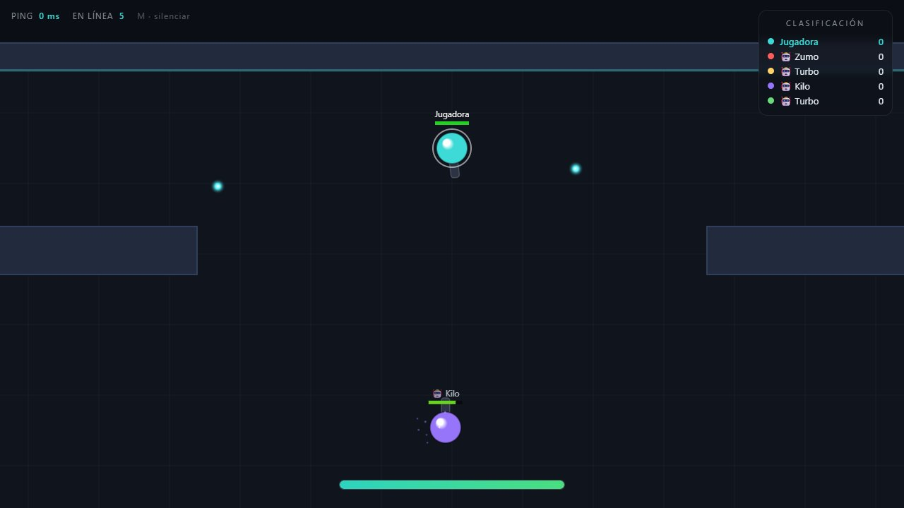

<p align="center"><a href="README.md">Español</a> · <b>English</b></p>

<div align="center">

# NEON ARENA

**Real-time multiplayer 2D PvP shooter, playable in the browser.**




</div>

- **Authoritative server** in Node.js with WebSockets (physics at 30 Hz, snapshots at 20 Hz).
- **Smooth client**: local prediction with reconciliation, interpolation of remote entities (~120 ms) and rendering at the monitor's refresh rate with Canvas.
- Bots that fill the arena when there are few players (they leave as humans join).
- Particle effects, sound synthesized with WebAudio (no audio files), leaderboard, kill feed and health regeneration.

## How to run it

```bash
npm install
npm start
```

Open **http://localhost:3000** in your browser. Each tab/browser is one player.

### Environment variables

| Variable | Default | Description |
|----------|---------|-------------|
| `PORT`   | `3000`  | Server port |
| `BOTS`   | `3`     | Maximum number of bots filling the arena (`BOTS=0` to disable them) |

## Controls

- **WASD / arrow keys** — move
- **Mouse** — aim
- **Left click / space** — shoot
- **M** — mute the sound

## Playing with other people

- **Same network (LAN):** share your local IP (`ipconfig` → IPv4), e.g. `http://192.168.1.50:3000`. Windows may ask for firewall permission for Node the first time.
- **Internet:** deploy the project on any service that runs Node (Render, Railway, Fly.io, a VPS…). It is a single process (`node server.js`) and respects the `PORT` variable, so it works with no extra configuration. Over HTTPS the client uses `wss://` automatically.

## Structure

```
server.js          HTTP + WebSocket server, authoritative simulation and bots
public/shared.js   Constants and movement physics shared by client/server
public/client.js   Rendering, prediction/interpolation, HUD, audio and effects
public/index.html  Game page
public/style.css   HUD and menu styles
```

> There is no GitHub Pages version because the game needs its Node server (WebSocket) for the authoritative simulation.

## License

[MIT](LICENSE) © 2026 virtuanista

<p align="center">
	Repository made by <a href="https://github.com/virtuanista" target="_blank">virtu 🎣</a>
</p>

<p align="center">
	
</p>

<p align="center">
	Copyright &copy; 2026
</p>

<p align="center">
	<a href="LICENSE"></a>
</p>
