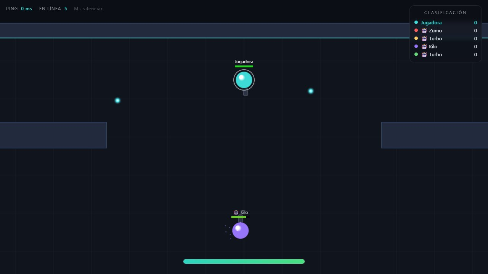

<div align="center">

# NEON ARENA

**Shooter PvP 2D multijugador en tiempo real, jugable desde el navegador.**




</div>

- **Servidor autoritativo** en Node.js con WebSockets (física a 30 Hz, snapshots a 20 Hz).
- **Cliente fluido**: predicción local con reconciliación, interpolación de entidades remotas (~120 ms) y render a la tasa del monitor con Canvas.
- Bots que rellenan la arena cuando hay pocos jugadores (se retiran al entrar humanos).
- Efectos de partículas, sonido sintetizado con WebAudio (sin ficheros de audio), clasificación, kill feed y regeneración de vida.

## Cómo ejecutarlo

```bash
npm install
npm start
```

Abre **http://localhost:3000** en el navegador. Cada pestaña/navegador es un jugador.

### Variables de entorno

| Variable | Por defecto | Descripción |
|----------|-------------|-------------|
| `PORT`   | `3000`      | Puerto del servidor |
| `BOTS`   | `3`         | Bots máximos que rellenan la arena (`BOTS=0` para desactivarlos) |

## Controles

- **WASD / flechas** — moverse
- **Ratón** — apuntar
- **Clic izquierdo / espacio** — disparar
- **M** — silenciar el sonido

## Jugar con otras personas

- **Misma red (LAN):** comparte tu IP local (`ipconfig` → IPv4), p. ej. `http://192.168.1.50:3000`. Windows puede pedir permiso en el firewall para Node la primera vez.
- **Internet:** despliega el proyecto en cualquier servicio que ejecute Node (Render, Railway, Fly.io, un VPS…). Es un único proceso (`node server.js`) y respeta la variable `PORT`, así que funciona sin configuración extra. Con HTTPS el cliente usa `wss://` automáticamente.

## Estructura

```
server.js          Servidor HTTP + WebSocket, simulación autoritativa y bots
public/shared.js   Constantes y física de movimiento compartidas cliente/servidor
public/client.js   Render, predicción/interpolación, HUD, audio y efectos
public/index.html  Página del juego
public/style.css   Estilos del HUD y los menús
```

> No hay versión en GitHub Pages porque el juego necesita su servidor Node (WebSocket) para la simulación autoritativa.

## Licencia

[MIT](LICENSE) © 2026 virtuanista
